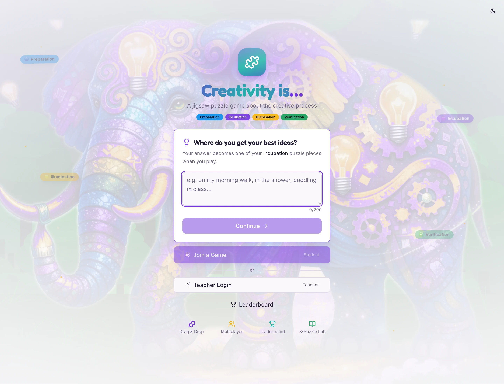
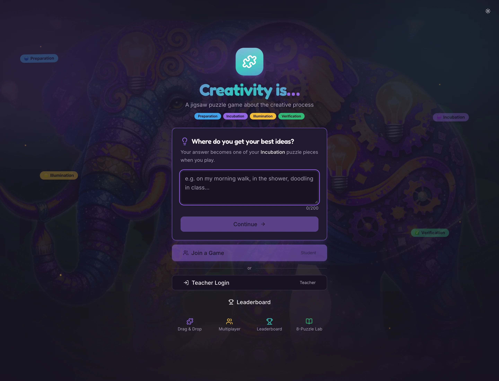

# Creativity is… — a jigsaw puzzle game about the creative process

A classroom-ready, real-time puzzle game for teaching the four stages of creativity. Students
assemble an elephant illustration by placing stage keys and matching quotes; a teacher runs the
session from a live dashboard.

Built with React 18, TypeScript, Vite, Tailwind CSS and Supabase (Postgres, Realtime, Auth).



<details>
<summary>Dark theme</summary>



</details>

---

## Overview

The game teaches **four stages of the creative process** — Preparation, Incubation, Illumination
and Verification. Each stage owns one column of the board. The top row holds the four stage keys;
every row below it holds quotes belonging to that column's stage.

A student's own answer to *"Where do you get your best ideas?"* is injected into the board as a
guaranteed Incubation quote, so the puzzle contains something they wrote themselves.

Sessions are real-time: the teacher creates a game, shares a 6-character code, and every player's
board and score update live.

## Gameplay

**Two phases, one board.**

1. **Phase 1 — stage keys.** Place the four stage keys (Preparation, Incubation, Illumination,
   Verification) in the top row.
2. **Phase 2 — quotes.** Each remaining slot takes a quote from the stage above it. Higher
   difficulties add more quote rows.

**Interaction is tap-to-place**, on desktop and mobile alike: tap a piece in the tray, then tap the
slot you think it belongs to. There is no drag-and-drop; a mis-tap is simply rejected with a shake
and a sound, and counts as a miss.

**Decoys.** From Medium upwards, the tray also contains quote pieces that belong to no slot.
Placing one costs points, so the tray is not a free-for-all — it has to be read.

**Combos.** Consecutive correct placements build a streak worth bonus **XP** (20 + 5 per streak
step). XP is a live, in-session flourish shown on screen; the score that reaches the leaderboard is
computed by the formula below and does not include XP.

### The four stages

| Stage | Column | Theme |
|---|---|---|
| Preparation | 1 | Laying the groundwork |
| Incubation | 2 | Letting ideas develop in the background |
| Illumination | 3 | The moment of insight |
| Verification | 4 | Testing and proving the idea |

Each stage carries a pool of six quotes; one is selected per game, so two sessions on the same
difficulty do not present an identical board.

## Difficulty and scoring

Difficulty changes **both the grid and the clock**, not just the timer.

| Difficulty | Grid | Time limit | Multiplier | Decoys |
|---|---|---|---|---|
| Easy | 4 × 3 | none | ×1 | 0 |
| Medium | 4 × 4 | 5 minutes | ×1.5 | 1 |
| Hard | 4 × 5 | 3 minutes | ×2 | 2 |
| Very Hard | 4 × 6 | 90 seconds | ×3 | 3 |

Score for a completed board:

```
base       = pieces × 40
time       = floor(elapsed_seconds)          # 1 point per second
misses     = incorrect_attempts × 15
raw        = max(base − time − misses, 50)   # floor of 50
score      = round(raw × multiplier)
```

Running out of time still records the score, but the result is stored as **incomplete** — it never
counts as a win and never enters the all-time leaderboard. Only a finished board does.

> Invariant worth knowing if you change the grid: each column draws all its quotes from a single
> stage, so `rows − 1` must never exceed the number of quotes per stage. That is why every stage
> holds six quotes, and it is asserted in `src/test/gameData.test.ts`.

## Roles

**Students** need no account. They sign in anonymously, answer the best-ideas prompt (their answer
becomes a puzzle piece), then join with a code or a shared link.

**Teachers** create an account with email and password, then create sessions, set difficulty,
start/pause/end rounds, kick players, broadcast a message to the room, and export results as CSV.

The teacher's dashboard shows a join code and QR code, a live scoreboard, and per-player time,
misses and completion state.

## Routes

| Path | Page | Notes |
|---|---|---|
| `/` | Landing | Join / teacher login / leaderboard entry points |
| `/teacher/login` | Teacher portal | Sign in, sign up, demo account |
| `/lobby/:sessionId` | Lobby | Waiting room; teacher starts the round here |
| `/game/:sessionId` | Board | The puzzle itself |
| `/results/:sessionId` | Results | Final scoreboard and full artwork |
| `/dashboard/:sessionId` | Teacher dashboard | Live control panel |
| `/leaderboard` | All-time leaderboard | Aggregated across sessions |
| `/lab07/game` | Puzzle lab | Standalone 8-puzzle and sliding-picture puzzles |
| `*` | 404 | Not-found page |

Landing and 404 load eagerly; every other route is code-split with `React.lazy`.

## Tech stack

| Layer | Choice |
|---|---|
| Framework | React 18.3 + TypeScript 5.8 |
| Build | Vite 5.4 |
| Styling | Tailwind CSS 3.4, shadcn/ui (Radix primitives) |
| Animation | Framer Motion 12 |
| Routing | React Router 7 |
| Backend | Supabase — Postgres, Realtime (`postgres_changes`), Auth |
| Toasts | Sonner |
| Tests | Vitest 3 + Testing Library (jsdom) |

The dependency list is deliberately small: 20 runtime packages. Only the twelve `components/ui/`
primitives the app actually renders are kept — the rest of the shadcn scaffold was removed along
with the packages only it used. Re-add a primitive with
`npx shadcn@latest add <name>` if a future screen needs one.

## Getting started

**Prerequisites:** Node.js 18 or newer, npm, and a Supabase project.

```bash
npm install
cp .env.example .env      # then fill in your Supabase values
npm run dev               # http://localhost:8080
```

### Environment

| Variable | Required | Purpose |
|---|---|---|
| `VITE_SUPABASE_URL` | yes | Project URL, e.g. `https://xxxx.supabase.co` |
| `VITE_SUPABASE_PUBLISHABLE_KEY` | yes | Public **anon** key |
| `SUPABASE_SERVICE_ROLE_KEY` | no | Only for the demo-user seed script; never expose to the client |

`VITE_`-prefixed variables are **inlined into the client bundle at build time**. Treat them as
public: the anon key is safe to ship because row-level security does the enforcement, but the
service-role key is not and must never be prefixed with `VITE_`.

If the two required variables are missing, the app still loads and logs an actionable error rather
than white-screening; sign-in and score saving will fail until they are set.

### Supabase setup

Full walkthrough: **[supabase/README.md](supabase/README.md)**. In short:

1. Create a project at [supabase.com](https://supabase.com).
2. Copy the URL and anon key from **Project Settings → API** into `.env`.
3. Apply the schema — `supabase link && supabase db push`, or run `supabase/run-all-migrations.sql`
   in the SQL editor.
4. Enable the **Email** and **Anonymous** auth providers.
5. Optional demo teacher: create `demo.teacher@puzzle.com` / `Teacher2024!` in the dashboard, or set
   `SUPABASE_SERVICE_ROLE_KEY` and run `npm run db:seed-demo`.

The demo credentials are shown on the login page by design, so it is a shared account — create real
teacher accounts for actual classroom use.

### Scripts

| Command | What it does |
|---|---|
| `npm run dev` | Dev server with HMR on port 8080 |
| `npm run build` | Production build to `dist/` |
| `npm run preview` | Serve the built output locally |
| `npm run lint` | ESLint over the whole repo |
| `npm run typecheck` | `tsc --noEmit` |
| `npm test` | Full Vitest suite, single run |
| `npm run test:watch` | Vitest in watch mode |
| `npm run smoke` | Browser smoke test against `dist/` in headless Chrome (needs `npm run build` first) |
| `npm run db:seed-demo` | Create the demo teacher (needs the service-role key) |
| `npm run supabase:push` | Push migrations to the linked project |

## Testing

```bash
npm run typecheck && npm run lint && npm test && npm run build
```

The suite covers the parts where a bug is silent — the score maths, the grid-scaling invariant,
leaderboard write de-duplication, CSV escaping, the retry paths, and the board itself:

| File | Covers |
|---|---|
| `src/test/gameData.test.ts` | Scoring (including negative/`NaN` time), grid scaling and the solvability invariant, decoy pool, game codes, quote injection |
| `src/test/jigsaw-flow.test.tsx` | A full playthrough of the real board: all four keys placed, the 2.2 s phase transition, every quote matched to its column, wrong taps rejected, decoys refused in every column, and `onCompleted` firing exactly once |
| `src/test/update-score.test.ts` | Row recovery when the player hasn't loaded, success/failure reporting, the timeout write guard |
| `src/test/retry-feedback.test.tsx` | Error states and retry toasts on the leaderboard and dashboard |
| `src/test/backend-down.test.tsx` | The landing page when the backend is unreachable: it must name the failure rather than disable `Join a Game` silently |
| `src/test/csv.test.ts` | RFC-4180 quoting and CSV-injection guarding |
| `src/lib/bestIdeasAnswer.test.ts` | Answer normalisation |

Test config lives in `vitest.config.ts` (Vitest ignores a `test` block in `vite.config.ts` when that
file exists). `src/test/setup.ts` stubs `matchMedia` and `scrollTo`, both of which jsdom leaves
unimplemented and Framer Motion calls during layout.

Timeouts are raised to 20 s. jsdom has no layout engine, so mounting the landing page (Framer Motion,
lazy routes) can take several seconds, and a test that times out mid-render resolves *after* cleanup
and fails every subsequent test in the same file — one slow render used to cascade into six failures.

## Deployment

The output in `dist/` is a static single-page app. It is deployed at
[creative-puzzle-studio.vercel.app](https://creative-puzzle-studio.vercel.app), auto-deployed from
`main` by Vercel.

1. `npm ci && npm run build`
2. Publish `dist/` to any static host.
3. **A rewrite so every path serves `index.html` is mandatory.** Without it, deep links such as
   `/results/ABC123` return the *host's* 404 page instead of the app. Vercel picks this up from the
   `vercel.json` in this repo, which also marks `/assets/*` immutable. On Netlify use
   `/* /index.html 200`; on GitHub Pages, a `404.html` copy of `index.html`.
   > This is not theoretical — the site shipped for months with only `/` working, because the
   > rewrite was documented but never configured. `npm run smoke` now catches it: the 404 assertion
   > matches the app's own "Oops! Page not found" copy, so a host-level 404 fails the check.
4. Set `VITE_SUPABASE_URL` and `VITE_SUPABASE_PUBLISHABLE_KEY` in the host's build environment
   **before** building — they are baked in at build time, not read at runtime.
5. Add the deployed origin to Supabase **Authentication → URL Configuration** so email confirmation
   links point back at your site.

To verify a live deployment rather than the local build:

```bash
SMOKE_BASE_URL=https://creative-puzzle-studio.vercel.app npm run smoke
```

The suite assumes the target has **no reachable Supabase project** — true of both the local build and
the current deployment — and asserts that the landing page names the failure instead of dead-ending.
Once an origin is wired to a live project, set `SMOKE_BACKEND_UP=1` to check the healthy path (the
best-ideas question) instead.

## Project structure

```
src/
  components/       UI, game board, theme provider, instructions
  components/ui/    the twelve shadcn/ui primitives the app renders
  hooks/            auth, session, best-ideas, theme
  lib/              game data and scoring, grid config, CSV, clipboard, audio
  pages/            one module per route
  test/             Vitest suites and setup
  integrations/     generated Supabase client and types
supabase/           migrations, combined SQL, setup guide
scripts/            demo-user seed script
```

### Repository contents

This repository also carries material that is **not** part of the built app, kept for reference:

- `JigsawPuzzle-main/` — a Unity jigsaw prototype used as a design reference. Unlicense (public
  domain); not compiled or shipped by the web build.
- `puzzle_design 2/` — early design specification, asset inventory and an abandoned prototype.
- `deliverables/` — QA reports and screenshots from the review passes.
- `JIGSAW_PUZZLE_*.md`, `MOBILE_OPTIMIZATION.md`, `TESTING_GUIDE.md` — historical design and testing
  notes. `README.md` is the current description of the app.

None of these are imported by `src/`; deleting them would not affect the build.

## Security notes

**See [`SECURITY.md`](SECURITY.md) for the full picture** — what the Supabase publishable key does
and does not grant, why rotating it does not hide it, and the contributor rule that every new table
ships with RLS and its policies in the same migration.

- **`.env` is not committed.** It was tracked before commit `8d66b33`, so older clones carry the
  project URL and anon key in their history. Both are public by design — they ship in the client
  bundle of every build — so row-level security is what actually protects the data.
- Row-level security is enabled on all four tables (25 policies); players may read sessions they
  belong to and update only their own row.
- Nicknames are user input and are escaped on CSV export (quoted per RFC 4180 and prefixed against
  spreadsheet formula injection).
- **`npm audit --omit=dev` is clean.** React Router is on 7.18.5, which resolves both advisories
  that previously required a major upgrade. `ws` is pinned via an `overrides` entry to a patched
  8.22.x because `@supabase/realtime-js` ships an older copy. Dev-only advisories are cleared too.

## License

No license is granted. The repository is marked `UNLICENSED` in `package.json`; add a license file
if you intend to distribute it. `JigsawPuzzle-main/` carries its own Unlicense and is unaffected.
